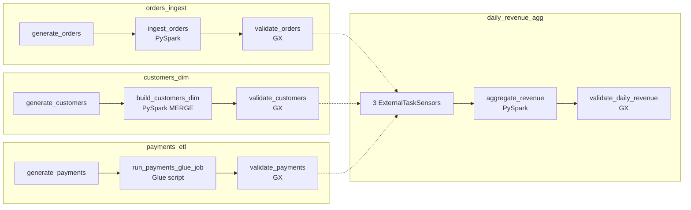
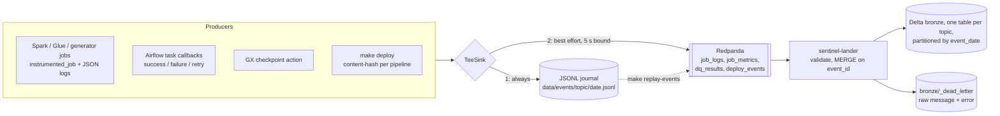

# PipelineSentinel


<!-- CI badge is added in Phase 6, once .github/workflows/ci.yml exists:
[](https://github.com/ArjHub/Pipeline-Sentinel/actions/workflows/ci.yml) -->

A self-diagnosing data pipeline platform. It monitors batch pipelines, detects failures
and data drift, and uses an LLM to explain the likely root cause and suggest a fix. A
human then approves any retry from Slack.

> **Status: Phase 2 of 6 (event stream).** Each phase lands as its own commit and tag.
> Sections marked *(Phase N)* describe work that hasn't been built yet.

| Phase | Scope | State |
|---|---|---|
| 1 | Pipelines to monitor: 4 DAGs, Spark + Glue-shim jobs, GX suites, structured events | ✅ done |
| 2 | Event stream: Redpanda producers, Delta bronze lander, deploy events, replay | ✅ done |
| 3 | Detection: failed jobs, schema drift, late data, volume anomalies, suppression | ⏳ |
| 4 | Diagnosis agent (Claude, tool use) + Slack Block Kit + FastAPI retry endpoint | ⏳ |
| 5 | Benchmark: 30 labelled faults, accuracy/latency/cost, manual baseline | ⏳ |
| 6 | Terraform (plan only), CI, Grafana dashboard, final docs | ⏳ |

## Data: synthetic only

**Every row in this repo is generated by `pipelines/generators/` from a fixed seed.**
Nothing here comes from any employer, client, or real person. Emails look like
`customer_123@example.com`, and IDs are sequential.

## What's real, what's mocked, what's only validated by `terraform plan`

| Component | Locally | Notes |
|---|---|---|
| Airflow 2.11 (LocalExecutor, Postgres) | **Real** | Runs in docker compose |
| PySpark 3.5.4 + Delta Lake 3.3.0 jobs | **Real** | Local mode inside the Airflow container |
| `payments_etl` Glue job | **Real PySpark, Glue APIs shimmed** | `glue_compat` runs the same script without `awsglue`. DynamicFrames, bookmarks and the Glue catalog are *not* exercised locally (LocalStack Glue is a paid feature) |
| Great Expectations 1.24 suites | **Real** | |
| Kafka API (Redpanda v26) | **Real** | Jobs, Airflow callbacks, GX and the deploy recorder publish; the lander consumes into Delta bronze |
| Prometheus + Grafana + statsd-exporter | **Real** | Airflow metrics scraped; dashboard comes in Phase 6 |
| Claude diagnosis agent *(Phase 4)* | **Real API** if `ANTHROPIC_API_KEY` is set; a fake LLM in tests | Hard budget cap, enforced by a cost ledger |
| Slack *(Phase 4)* | **Mocked**: local mock-Slack page + signed requests to the real FastAPI handler | A real-Slack setup guide will be provided; not tested against real Slack |
| AWS (S3, Glue, ECS/EC2 Airflow, single-node Kafka, IAM) *(Phase 6)* | **`terraform plan` only** | Never applied. No AWS resources are created by this project |

## Quickstart

Prerequisites: Docker Desktop with **≥ 8 GB** of memory, `make`, `python3` ≥ 3.11 (only
for small host-side scripts), and git.

```bash
make up        # creates .env with random secrets, builds the image, starts the stack, waits for health
make run-all   # runs all 4 DAGs for yesterday (UTC) and waits; exit 0 only if all succeed
make query     # row counts in the curated Delta tables + events emitted for that date
make query-bronze  # bronze event tables (row counts + samples) for that date
make test      # unit tests (incl. local Spark + GX + Delta) and DAG-integrity tests, in a container
make test-e2e  # end-to-end: trigger a DAG on the live stack, assert its events land in bronze
make down      # stop (keeps data);  `make clean` also deletes volumes and the lake
```

Pass `DATE=2026-10-20` to `run-all` / `query` to pick a date. Re-running a date is safe:
existing runs are cleared and re-run in place, and every write overwrites only its own
partition.

| UI | URL | Login |
|---|---|---|
| Airflow | http://localhost:8080 | `admin` / `AIRFLOW_ADMIN_PASSWORD` in `.env` |
| Grafana | http://localhost:3000 | `admin` / `GRAFANA_ADMIN_PASSWORD` in `.env` |
| Prometheus | http://localhost:9090 | none |

All ports bind to `127.0.0.1` only.

## The pipelines



| DAG | Input (raw) | Output (Delta) | Notes |
|---|---|---|---|
| `orders_ingest` | CSV, ~1.9k–2.6k rows/day, weekly seasonality ±3% noise | `curated/orders`, partitioned by `ds` | No silent dedupe: duplicates should fail DQ loudly |
| `customers_dim` | Full daily snapshot (5,000 + 25/day customers) | `curated/customers` (SCD1) | `MERGE` updates only rows with a newer `updated_at`, so re-runs are no-ops |
| `payments_etl` | JSON lines, one per completed order (97% coverage) | `curated/payments`, partitioned by `ds` | Same script would run on Glue 5.0 (Spark 3.5.4 / Delta 3.3.0, versions mirrored on purpose) |
| `daily_revenue_agg` | The three curated tables | `curated/daily_revenue` | Sensors fail fast if an upstream run fails |

**Data quality.** Each dataset has a GX suite (`pipelines/quality/suites.py`) covering
schema (exact column set), nulls, ranges and value sets, uniqueness, and **freshness**.
For example, the latest `order_ts` must fall within 2 h of the end of `ds`. A failed
expectation fails the task. The tests check that each class of bad data (null spike,
duplicate load, stale partition, added column, out-of-range value, bad email, paid > gross)
is caught by *the specific expectation that should catch it*.

**Telemetry.** Every job emits versioned JSON events (`src/sentinel/events/models.py`):
`job_log` (structured logs at INFO and above, with tracebacks), `job_metric` (status,
duration, rows in/out, *observed input schema*, error type/message) and `dq_result`
(every expectation outcome). Each event carries the Airflow `dag_id`, `run_id`,
`task_id`, logical date, try number and code version. In Phase 1 the events go to
`data/events/<topic>/<date>.jsonl`. Phase 2 swaps in a Kafka sink behind the same
interface.

**Known limitation.** `customers` is an SCD1 (current-state) dimension. Backfilling an
old `ds` therefore joins *today's* customer attributes, such as country. A point-in-time
join would need SCD2.

## Break it on purpose

The failure demo that Phases 3–5 build on (detection, diagnosis, the retry button). It
removes the `amount` column from one day's raw orders file, so the Spark job fails with
a schema error.

```bash
make run-all DATE=2026-10-20                       # start from a green run
F=data/lake/raw/orders/ds=2026-10-20/part-0000.csv
cp "$F" data/orders-backup.csv                     # 1. back up (data/ is git-ignored)
cut -d, -f1-3,5- data/orders-backup.csv > "$F"     # 2. drop column 4 (amount)
head -1 "$F"                                       #    order_id,customer_id,order_ts,currency,status

# 3. Re-run ONLY ingest_orders (+ downstream). Don't clear generate_orders: it would
#    regenerate a correct file and "fix" the fault.
docker compose exec airflow-scheduler \
  airflow tasks clear orders_ingest -t '^ingest_orders$' -s 2026-10-20 -e 2026-10-20 -d -y
```

The UI equivalent of step 3: **DAGs → orders_ingest → run `run_all__2026-10-20` →
ingest_orders → Clear**, with "Downstream" on and "Upstream" off.

4. **Read the log.** Open **ingest_orders → Logs** in the Airflow UI (or look at the
   newest file under `/opt/airflow/logs/dag_id=orders_ingest/run_id=run_all__2026-10-20/task_id=ingest_orders/`).
   The task is `failed` and the log contains:
   ```
   SchemaMismatchError: orders: missing required columns ['amount']; observed columns ['order_id', 'customer_id', 'order_ts', 'currency', 'status']
   ```
   A `job_metric` event with `status=failed` and `error_type=SchemaMismatchError` is
   also written to `data/events/job_metrics/`.

5. **Restore and re-run:**
   ```bash
   mv data/orders-backup.csv "$F"
   docker compose exec airflow-scheduler \
     airflow tasks clear orders_ingest -t '^ingest_orders$' -s 2026-10-20 -e 2026-10-20 -d -y
   ```
   `ingest_orders` and `validate_orders` go green again.

## The event stream (Phase 2)



| Topic | Event types | Produced by |
|---|---|---|
| `job_logs` | `job_log` | Every job's structured logs (INFO+), plus an ERROR log with the **task log tail** from the Airflow failure callback |
| `job_metrics` | `job_metric`, `task_run` | `job_metric`: the job wrapper (status, duration, rows, observed input schema, Spark version). `task_run`: Airflow callbacks for every task attempt, which also covers OOM kills and sensor timeouts where the job can't report itself |
| `dq_results` | `dq_result` | The GX checkpoint action (every expectation outcome) |
| `deploy_events` | `deploy_event` | `make deploy`: per pipeline, the code version, previous version, changed files, git SHA and a dirty flag |

**Contract.** `src/sentinel/events/models.py` (Pydantic), exported to
[`schemas/event.schema.json`](schemas/event.schema.json); a test fails if the two drift.
Every event has `schema_version`, `event_id`, `event_type`, `pipeline`, `run_id`,
`task_id`, `logical_date`, `try_number`, `code_version`, `emitted_at` and a typed
`payload`. A MINOR version bump is additive, and consumers accept any MINOR of a
supported MAJOR. An unsupported MAJOR goes to dead-letter.

**Code versions.** `make deploy` (run automatically by `make up` and `make run-all`)
hashes each pipeline's files, which are its DAG and job modules plus the shared modules.
It emits a `deploy_event` only for pipelines whose content changed. Every later event
from that pipeline carries the new `code_version`, for example `a98cec4` or
`a98cec4-dirty.d2857617` for an uncommitted edit.

**When Redpanda is down.** This was measured with `docker compose stop redpanda` followed
by `make run-all DATE=2026-10-19`. All 4 DAGs still succeeded, and all 58 events were in
the journal. Each task log said `N event(s) not delivered to Kafka ... run make
replay-events`. The run took **152 s instead of ~70 s**, because every job process waits
up to `SENTINEL_KAFKA_TIMEOUT_MS` (5 s) when it flushes. After `docker compose start
redpanda && make replay-events`, bronze had exactly those 58 rows. Replaying again
inserted 0 rows and counted 276 as duplicates.

**`make replay-events` waits for the lander.** After publishing, it polls the
`sentinel-lander` consumer group's committed offsets against each partition's high
watermark (the numbers `rpk group describe` shows) until the lag is 0 on all four topics.
Then it prints `lander caught up`. If that hasn't happened after 180 s, it prints a
warning with the commands to check and exits 1. The bronze query is only complete after
`lander caught up`.

**Reconnecting after a broker restart.** Redpanda restores the consumer group, including
the lander's old member, from `__consumer_offsets`. A normal rejoin then waited about
30 s for that old member to expire. This was measured as the time from "Redpanda healthy"
to "lander caught up", with 90 s and 150 s outages, and the original 30 s session
timeout, 30 s connection-setup timeout and 10 s maximum backoff. The lander now uses
**static group membership** (`group.instance.id=sentinel-lander-0`), so a rejoining
lander replaces its old member immediately. The same 150 s outage now takes **2 s**. It is
safe because exactly one lander runs. A second consumer in the group, such as a one-off
`python -m sentinel.lander --drain`, must pass its own `--instance-id`, or the broker
fences one of the two. Session and connection-setup timeouts were also cut to 10 s and
5 s, and the maximum reconnect backoff to 2 s. On their own those didn't change the
measured 30 s, but they make a dead broker show up sooner. Expect a few more seconds while
Docker DNS re-registers the `redpanda` name after `docker compose start`.

```bash
make query-bronze DATE=2026-10-20     # bronze counts + samples (filtered by business date)
make replay-events [DAY=2026-10-21]   # journal -> Redpanda (DAY = emitted date; default all)
make deploy                           # record code versions now
docker compose logs -f sentinel-lander
```

### Known limitations (event stream)

- **A run with the broker down takes about 2× as long** (152 s vs about 70 s for `run-all`).
  Each job process waits up to 5 s for Kafka when it flushes. This is accepted
  deliberately: the journal keeps every event, and replay is idempotent. A circuit
  breaker that skips publishing after the first timeout would save the time, but it adds
  shared state between task processes for a failure mode that is rare and visible. It
  isn't built.
- **The lander crash-loops on a failed Delta write, by design.** If writing a batch to
  bronze raises an error (disk full, corrupt table, permissions), the process exits
  *without* committing offsets. Docker restarts it (`restart: unless-stopped`), and it
  retries the same batch, so nothing is skipped or lost. The cost is that a persistent
  write error keeps the lander restarting, and bronze stops advancing until someone
  fixes it. A malformed *message* is different: it goes to `_dead_letter` and never
  blocks the stream. Today you notice a crash loop through `docker compose ps`
  (restarting) or a stale `sentinel_lander_last_success_timestamp`. *(Phase 6)* A
  Prometheus alert on that metric and on container restarts will page instead.

## Measured resource use (Phase 2, lander running)

Measured with `make mem-profile DATE=2026-10-19` (samples `docker stats` every 2 s during
`make run-all`) on an Apple Silicon MacBook (16 GB) with Docker Desktop set to 8 GB, on
2026-10-23, with all eight services up, including `sentinel-lander`:

| Container | Idle MiB | Peak MiB |
|---|---:|---:|
| airflow-scheduler (runs the Spark JVMs) | 688 | 2,250 |
| airflow-webserver | 1,483 | 1,488 |
| sentinel-lander | 251 | 455 |
| grafana | 208 | 208 |
| prometheus | 161 | 161 |
| redpanda | 158 | 158 |
| postgres | 78 | 82 |
| statsd-exporter | 41 | 42 |
| **Total** (idle sum / highest simultaneous total) | **3,066** | **4,627** |

The Phase 1 peak was 4,190 MiB without the lander. The lander's peak happens while it
MERGEs a batch into bronze. *(The first Phase 2 profile reported a 6,361 MiB total. That
was a bug in `mem_profile.sh`: a sample cut short when the sampler was stopped got merged
into the next one. It is fixed, and the per-container peaks were unaffected.)*

A full `run-all` takes about 65–75 s on its own. The profiled run above took 109 s,
because sampling `docker stats` every 2 s competes for the same CPU. Each Spark job runs
7–14 s, mostly JVM start-up.

## Reproducibility

- **Images** are pinned by tag *and* multi-arch digest in `docker-compose.yml` and the
  Dockerfile.
- **Python** deps are installed with `--require-hashes` from `requirements/*.lock.txt`
  (compiled by `make lock` using a pinned `uv`). Airflow itself uses the official
  `constraints-2.11.2` file.
- **Delta jars** are downloaded at build time and verified against SHA-256 checksums.
- **The one unpinned input** is the Debian `openjdk-17-jre-headless` package (installed:
  `17.0.20.1+1-1~deb12u1`). Debian removes superseded versions from its mirrors, so an
  exact pin would break fresh builds.
- **Synthetic data** is a pure function of `(SENTINEL_SEED, dataset, ds)`.

## Benchmark honesty notes *(Phase 5)*

- **The manual baseline is only partially blind.** The faults are injected in randomized
  order and labels stay hidden until each diagnosis is recorded. But the person timing
  the manual baseline (the author) saw the fault *types* while building the harness, so
  they had prior knowledge of the category set.
- Only 10 of the 30 faults (about 2 per category) are timed by hand. The other 20 are
  reported as "not manually timed" and are never estimated.

## Security (so far)

- No credentials in code. `.env` is created locally with random secrets (`make env`), is
  `chmod 600`, and is git-ignored. `.env.example` documents every key.
- All service ports bind to localhost. Grafana sign-up is disabled, and Airflow's config
  page is hidden.
- *(Phase 4)* Log redaction before the LLM, Slack signature verification, a DAG
  allowlist, and an audit log. *(Phase 6)* Least-privilege IAM.

## Repo layout

```
pipelines/   dags/ jobs/ generators/ quality/ common/   # the pipelines being monitored
src/sentinel/ events/ (models, sinks, replay, schema) instrumentation/ (job wrapper, logging,
             airflow_callbacks) lander/ (bronze writer, consume loop) deploy.py airflow_client.py
schemas/     event.schema.json                          # generated contract (make schemas)
docker/      airflow/Dockerfile
observability/ prometheus/ statsd/ grafana/
scripts/     run_all.py query_lake.py query_bronze.py init_env.sh wait_healthy.sh mem_profile.sh create_topics.sh
tests/       unit/ dags/ integration/
docs/        architecture.md
```

See [docs/architecture.md](docs/architecture.md) for the full target architecture and
design decisions.

## License

[MIT](LICENSE) © 2026 Arjun P
