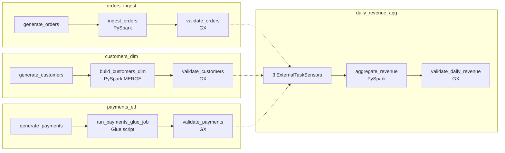
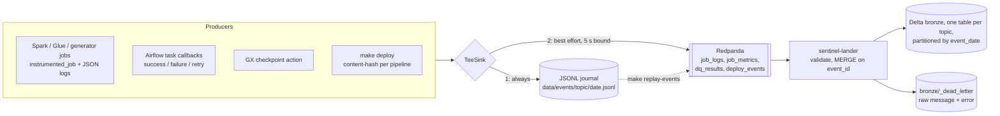
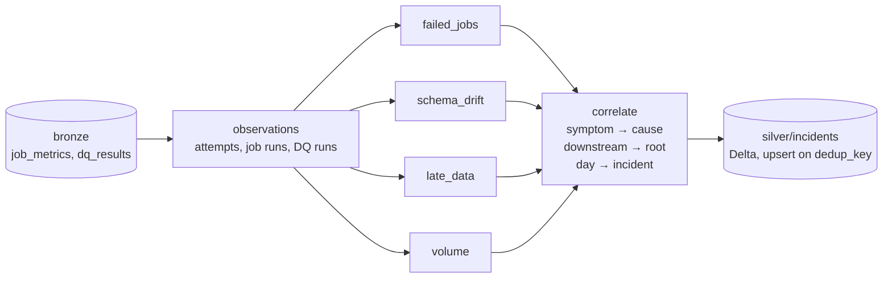

# PipelineSentinel


<!-- CI badge is added in Phase 6, once .github/workflows/ci.yml exists:
[](https://github.com/ArjHub/Pipeline-Sentinel/actions/workflows/ci.yml) -->

A self-diagnosing data pipeline platform. It monitors batch pipelines, detects failures
and data drift, and uses an LLM to explain the likely root cause and suggest a fix. A
human then approves any retry from Slack.

> **Status: Phase 3 of 6 (detection).** Each phase lands as its own commit and tag.
> Sections marked *(Phase N)* describe work that hasn't been built yet.

| Phase | Scope | State |
|---|---|---|
| 1 | Pipelines to monitor: 4 DAGs, Spark + Glue-shim jobs, GX suites, structured events | ✅ done |
| 2 | Event stream: Redpanda producers, Delta bronze lander, deploy events, replay | ✅ done |
| 3 | Detection: failed jobs, schema drift, late data, volume anomalies, suppression | ✅ done |
| 4 | Diagnosis agent (Claude, tool use) + Slack Block Kit + FastAPI retry endpoint | ⏳ |
| 5 | Benchmark: 30 labelled faults, accuracy/latency/cost, manual baseline | ⏳ |
| 6 | Terraform (plan only), CI, Grafana dashboard, final docs | ⏳ |

## Data: synthetic only

**Every row in this repo is generated by `pipelines/generators/` from a fixed seed.**
Nothing here comes from any employer, client, or real person. Emails look like
`customer_123@example.com`, and IDs are sequential.

## What's real, what's mocked, what's only validated by `terraform plan`

| Component | Locally | Notes |
|---|---|---|
| Airflow 2.11 (LocalExecutor, Postgres) | **Real** | Runs in docker compose |
| PySpark 3.5.4 + Delta Lake 3.3.0 jobs | **Real** | Local mode inside the Airflow container |
| `payments_etl` Glue job | **Real PySpark, Glue APIs shimmed** | `glue_compat` runs the same script without `awsglue`. DynamicFrames, bookmarks and the Glue catalog are *not* exercised locally (LocalStack Glue is a paid feature) |
| Great Expectations 1.24 suites | **Real** | |
| Kafka API (Redpanda v26) | **Real** | Jobs, Airflow callbacks, GX and the deploy recorder publish; the lander consumes into Delta bronze |
| Detection (4 detectors + correlation → Delta `incidents`) | **Real** | Batch pass over bronze, run by `make detect` (not scheduled yet) |
| Prometheus + Grafana + statsd-exporter | **Real** | Airflow metrics scraped; dashboard comes in Phase 6 |
| Claude diagnosis agent *(Phase 4)* | **Real API** if `ANTHROPIC_API_KEY` is set; a fake LLM in tests | Hard budget cap, enforced by a cost ledger |
| Slack *(Phase 4)* | **Mocked**: local mock-Slack page + signed requests to the real FastAPI handler | A real-Slack setup guide will be provided; not tested against real Slack |
| AWS (S3, Glue, ECS/EC2 Airflow, single-node Kafka, IAM) *(Phase 6)* | **`terraform plan` only** | Never applied. No AWS resources are created by this project |

## Quickstart

Prerequisites: Docker Desktop with **≥ 8 GB** of memory, `make`, `python3` ≥ 3.11 (only
for small host-side scripts), and git.

```bash
make up        # creates .env with random secrets, builds the image, starts the stack, waits for health
make run-all   # runs all 4 DAGs for yesterday (UTC) and waits; exit 0 only if all succeed
make query     # row counts in the curated Delta tables + events emitted for that date
make query-bronze  # bronze event tables (row counts + samples) for that date
make detect    # run detection once over bronze; upsert the incidents table
make query-incidents  # list incidents (STATUS=open, ID=INC-... for full evidence)
make test      # unit tests (incl. local Spark + GX + Delta) and DAG-integrity tests, in a container
make test-e2e  # end-to-end: trigger a DAG on the live stack, assert its events land in bronze
make down      # stop (keeps data);  `make clean` also deletes volumes and the lake
```

Pass `DATE=2026-10-20` to `run-all` / `query` to pick a date. Re-running a date is safe:
existing runs are cleared and re-run in place, and every write overwrites only its own
partition.

| UI | URL | Login |
|---|---|---|
| Airflow | http://localhost:8080 | `admin` / `AIRFLOW_ADMIN_PASSWORD` in `.env` |
| Grafana | http://localhost:3000 | `admin` / `GRAFANA_ADMIN_PASSWORD` in `.env` |
| Prometheus | http://localhost:9090 | none |

All ports bind to `127.0.0.1` only.

## The pipelines



| DAG | Input (raw) | Output (Delta) | Notes |
|---|---|---|---|
| `orders_ingest` | CSV, ~1.9k–2.6k rows/day, weekly seasonality ±3% noise | `curated/orders`, partitioned by `ds` | No silent dedupe: duplicates should fail DQ loudly |
| `customers_dim` | Full daily snapshot (5,000 + 25/day customers) | `curated/customers` (SCD1) | `MERGE` updates only rows with a newer `updated_at`, so re-runs are no-ops |
| `payments_etl` | JSON lines, one per completed order (97% coverage) | `curated/payments`, partitioned by `ds` | Same script would run on Glue 5.0 (Spark 3.5.4 / Delta 3.3.0, versions mirrored on purpose) |
| `daily_revenue_agg` | The three curated tables | `curated/daily_revenue` | Sensors fail fast if an upstream run fails |

**Data quality.** Each dataset has a GX suite (`pipelines/quality/suites.py`) covering
schema (exact column set), nulls, ranges and value sets, uniqueness, and **freshness**.
For example, the latest `order_ts` must fall within 2 h of the end of `ds`. A failed
expectation fails the task. The tests check that each class of bad data (null spike,
duplicate load, stale partition, added column, out-of-range value, bad email, paid > gross)
is caught by *the specific expectation that should catch it*.

**Telemetry.** Every job emits versioned JSON events (`src/sentinel/events/models.py`):
`job_log` (structured logs at INFO and above, with tracebacks), `job_metric` (status,
duration, rows in/out, *observed input schema*, error type/message) and `dq_result`
(every expectation outcome). Each event carries the Airflow `dag_id`, `run_id`,
`task_id`, logical date, try number and code version. In Phase 1 the events go to
`data/events/<topic>/<date>.jsonl`. Phase 2 swaps in a Kafka sink behind the same
interface.

**Known limitation.** `customers` is an SCD1 (current-state) dimension. Backfilling an
old `ds` therefore joins *today's* customer attributes, such as country. A point-in-time
join would need SCD2.

## Break it on purpose

The failure demo that Phases 3–5 build on (detection, diagnosis, the retry button). It
removes the `amount` column from one day's raw orders file, so the Spark job fails with
a schema error.

```bash
make run-all DATE=2026-10-20                       # start from a green run
F=data/lake/raw/orders/ds=2026-10-20/part-0000.csv
cp "$F" data/orders-backup.csv                     # 1. back up (data/ is git-ignored)
cut -d, -f1-3,5- data/orders-backup.csv > "$F"     # 2. drop column 4 (amount)
head -1 "$F"                                       #    order_id,customer_id,order_ts,currency,status

# 3. Re-run ONLY ingest_orders (+ downstream). Don't clear generate_orders: it would
#    regenerate a correct file and "fix" the fault.
docker compose exec airflow-scheduler \
  airflow tasks clear orders_ingest -t '^ingest_orders$' -s 2026-10-20 -e 2026-10-20 -d -y
```

The UI equivalent of step 3: **DAGs → orders_ingest → run `run_all__2026-10-20` →
ingest_orders → Clear**, with "Downstream" on and "Upstream" off.

4. **Read the log.** Open **ingest_orders → Logs** in the Airflow UI (or look at the
   newest file under `/opt/airflow/logs/dag_id=orders_ingest/run_id=run_all__2026-10-20/task_id=ingest_orders/`).
   The task is `failed` and the log contains:
   ```
   SchemaMismatchError: orders: missing required columns ['amount']; observed columns ['order_id', 'customer_id', 'order_ts', 'currency', 'status']
   ```
   A `job_metric` event with `status=failed` and `error_type=SchemaMismatchError` is
   also written to `data/events/job_metrics/`.

5. **Restore and re-run:**
   ```bash
   mv data/orders-backup.csv "$F"
   docker compose exec airflow-scheduler \
     airflow tasks clear orders_ingest -t '^ingest_orders$' -s 2026-10-20 -e 2026-10-20 -d -y
   ```
   `ingest_orders` and `validate_orders` go green again.

### Break it on purpose, then detect it (Phase 3)

`make break-it` injects one of three faults on the live stack and waits until the
affected DAG runs finish. It prints every command it runs (`+ ...`), so you can also type
them yourself. Use a date you haven't used yet. Each fault takes 1–2.5 min.

| Fault | What it does to the raw data | What Airflow shows | Expected incident |
|---|---|---|---|
| `missing_amount` | Green run first, then cuts column 4 (`amount`) out of the orders CSV and re-runs `ingest_orders` and `daily_revenue_agg` | `ingest_orders` failed (SchemaMismatchError), `wait_for_orders_ingest` failed | **schema_change** on orders_ingest (`-amount`, high), failed task attached as a symptom; downstream daily_revenue_agg linked to it |
| `volume_drop` | Green run first, then keeps 1 orders row in 3 (`awk 'NR==1 \|\| NR%3==0'`), spread over the whole day, and re-runs | **Everything green.** Only a detector can catch this | **volume_anomaly** on orders_ingest (about −62 to −67%, high); downstream daily_revenue_agg rows_in drop linked to it |
| `stale_customers` | Never runs `generate_customers` for the date (marked success); serves the newest existing snapshot instead (two or more days old) | `validate_customers` failed (GX freshness), `wait_for_customers_dim` failed | **late_data** on customers_dim (about 48 h behind, SLA 24 h, high); downstream daily_revenue_agg linked to it |

```bash
make break-it FAULT=missing_amount  DATE=2026-10-12
make break-it FAULT=volume_drop     DATE=2026-10-13
make break-it FAULT=stale_customers DATE=2026-10-26   # >= 2 days after the newest customers date

make detect             # one pass over bronze; prints open primaries with their downstream
make query-incidents    # the table; STATUS=open to filter
make query-incidents ID=INC-xxxxxxxxxx   # full JSON evidence for one incident

make run-all DATE=2026-10-12 && make detect   # fix: regenerate + re-run -> status resolved
```

Run `make break-it FAULT=stale_customers` *last*, on the latest date. The customers dim
only moves forward (a MERGE never replaces a newer `updated_at` with an older one). So
once a newer snapshot has been loaded, an old file for an earlier date can't make the
dim stale. The script refuses a date that is less than two days after the newest
customers snapshot.

What `make detect` printed on the live stack (2026-10-23) after the three faults above,
on dates 2026-10-16 / 18 / 22:

```
findings: 10 (failed_job=5, late_data=1, schema_change=2, volume_anomaly=2)
incidents: 6 (primary=3, downstream=3)

open primary incidents: 3
  INC-c5962d3281  high   schema_change   orders_ingest      orders_ingest input schema changed vs last good run: -amount
      └─ INC-6a9663908b downstream daily_revenue_agg (open)
  INC-c47ffd2881  high   volume_anomaly  orders_ingest      orders_ingest.rows_in drop for ds=2026-10-18: 846 rows vs expected ~2198 (-62%, cold_start_ratio)
      └─ INC-9d219c1b04 downstream daily_revenue_agg (open)
  INC-a04953459f  high   late_data       customers_dim      customers is stale for ds=2026-10-22: latest updated_at is 48.08 h before end of day (SLA 24.0 h)
      └─ INC-da76dac503 downstream daily_revenue_agg (open)
```

Ten findings collapse into three primaries. The five failed tasks are either symptoms
attached to their cause or downstream sensor failures. The volume incident says
`cold_start_ratio` because the live lake has only a few days of history. With three or
more same-weekday points, it switches to the robust z-score. Ids are deterministic, so
the same fault for a new date gets the id shown above (see "Recurrences" below).

Two things that look like bugs but are intended:

- **Truncating instead of thinning** (`head -n 600` on the orders file) gives a
  **late_data** incident, not a volume one. A file that stops mid-morning is a partial
  delivery: its latest `order_ts` is hours before the end of the day *and* it is short.
  Both signals land in one incident, named by the higher-priority cause, with the volume
  drop listed as a second signal (`test_real_truncated_file_is_one_incident_with_two_signals`).
- **Recurrences reopen the same incident.** If the same fault comes back on another
  date, it joins its existing incident, even a resolved one. The incident then lists
  every affected date. For example, the 2026-10-16 `-amount` above reopened the incident
  from an earlier 2026-10-20 demo.

## The event stream (Phase 2)



| Topic | Event types | Produced by |
|---|---|---|
| `job_logs` | `job_log` | Every job's structured logs (INFO+), plus an ERROR log with the **task log tail** from the Airflow failure callback |
| `job_metrics` | `job_metric`, `task_run` | `job_metric`: the job wrapper (status, duration, rows, observed input schema, Spark version). `task_run`: Airflow callbacks for every task attempt, which also covers OOM kills and sensor timeouts where the job can't report itself |
| `dq_results` | `dq_result` | The GX checkpoint action (every expectation outcome) |
| `deploy_events` | `deploy_event` | `make deploy`: per pipeline, the code version, previous version, changed files, git SHA and a dirty flag |

**Contract.** `src/sentinel/events/models.py` (Pydantic), exported to
[`schemas/event.schema.json`](schemas/event.schema.json); a test fails if the two drift.
Every event has `schema_version`, `event_id`, `event_type`, `pipeline`, `run_id`,
`task_id`, `logical_date`, `try_number`, `code_version`, `emitted_at` and a typed
`payload`. A MINOR version bump is additive, and consumers accept any MINOR of a
supported MAJOR. An unsupported MAJOR goes to dead-letter.

**Code versions.** `make deploy` (run automatically by `make up` and `make run-all`)
hashes each pipeline's files, which are its DAG and job modules plus the shared modules.
It emits a `deploy_event` only for pipelines whose content changed. Every later event
from that pipeline carries the new `code_version`, for example `a98cec4` or
`a98cec4-dirty.d2857617` for an uncommitted edit.

**When Redpanda is down.** This was measured with `docker compose stop redpanda` followed
by `make run-all DATE=2026-10-19`. All 4 DAGs still succeeded, and all 58 events were in
the journal. Each task log said `N event(s) not delivered to Kafka ... run make
replay-events`. The run took **152 s instead of ~70 s**, because every job process waits
up to `SENTINEL_KAFKA_TIMEOUT_MS` (5 s) when it flushes. After `docker compose start
redpanda && make replay-events`, bronze had exactly those 58 rows. Replaying again
inserted 0 rows and counted 276 as duplicates.

**`make replay-events` waits for the lander.** After publishing, it polls the
`sentinel-lander` consumer group's committed offsets against each partition's high
watermark (the numbers `rpk group describe` shows) until the lag is 0 on all four topics.
Then it prints `lander caught up`. If that hasn't happened after 180 s, it prints a
warning with the commands to check and exits 1. The bronze query is only complete after
`lander caught up`.

**Reconnecting after a broker restart.** Redpanda restores the consumer group, including
the lander's old member, from `__consumer_offsets`. A normal rejoin then waited about
30 s for that old member to expire. This was measured as the time from "Redpanda healthy"
to "lander caught up", with 90 s and 150 s outages, and the original 30 s session
timeout, 30 s connection-setup timeout and 10 s maximum backoff. The lander now uses
**static group membership** (`group.instance.id=sentinel-lander-0`), so a rejoining
lander replaces its old member immediately. The same 150 s outage now takes **2 s**. It is
safe because exactly one lander runs. A second consumer in the group, such as a one-off
`python -m sentinel.lander --drain`, must pass its own `--instance-id`, or the broker
fences one of the two. Session and connection-setup timeouts were also cut to 10 s and
5 s, and the maximum reconnect backoff to 2 s. On their own those didn't change the
measured 30 s, but they make a dead broker show up sooner. Expect a few more seconds while
Docker DNS re-registers the `redpanda` name after `docker compose start`.

```bash
make query-bronze DATE=2026-10-20     # bronze counts + samples (filtered by business date)
make replay-events [DAY=2026-10-21]   # journal -> Redpanda (DAY = emitted date; default all)
make deploy                           # record code versions now
docker compose logs -f sentinel-lander
```

### Known limitations (event stream)

- **A run with the broker down takes about 2× as long** (152 s vs about 70 s for `run-all`).
  Each job process waits up to 5 s for Kafka when it flushes. This is accepted
  deliberately: the journal keeps every event, and replay is idempotent. A circuit
  breaker that skips publishing after the first timeout would save the time, but it adds
  shared state between task processes for a failure mode that is rare and visible. It
  isn't built.
- **The lander crash-loops on a failed Delta write, by design.** If writing a batch to
  bronze raises an error (disk full, corrupt table, permissions), the process exits
  *without* committing offsets. Docker restarts it (`restart: unless-stopped`), and it
  retries the same batch, so nothing is skipped or lost. The cost is that a persistent
  write error keeps the lander restarting, and bronze stops advancing until someone
  fixes it. A malformed *message* is different: it goes to `_dead_letter` and never
  blocks the stream. Today you notice a crash loop through `docker compose ps`
  (restarting) or a stale `sentinel_lander_last_success_timestamp`. *(Phase 6)* A
  Prometheus alert on that metric and on container restarts will page instead.

## Detection (Phase 3)



`make detect` is one pass: read bronze (the last `history_days` of `event_date`
partitions), run the four detectors, correlate, upsert. It's a batch job, deterministic
and idempotent. Running it twice writes nothing the second time (no new Delta version).
It reads **only bronze**, never Kafka, the curated tables or Airflow. All thresholds are
in [`config/detection.toml`](config/detection.toml). Every key is required, with no
hidden defaults (`SENTINEL_DETECTION_CONFIG` points elsewhere).

| Detector | Signal (from bronze) | Fires when | Clears when |
|---|---|---|---|
| failed_job | `task_run` with state `failed` (`job_metric` stands in if the callback never arrived) | a task attempt fails; grouped by task + error signature (error type, failed GX expectations, or the first line of the message with digits masked) | a later attempt of the same task doesn't fail that way |
| schema_change | `job_metric.input_schema` | the observed input columns differ (by name and Spark type) from the job's **last successful** run. A failed run never becomes the baseline; the first run seen is the baseline (cold start) | a later run matches the baseline again |
| late_data | the GX freshness outcome's **observed max** (e.g. `max(updated_at)`) | end of ds − observed max > the pipeline's SLA (2 h orders/payments, 24 h customers). Recomputed here, not taken from GX's pass/fail, so it knows *how* late. High at ≥ 2× SLA. Optional arrival SLA (final task done by end of ds + N h), off locally because DAGs aren't scheduled | a later DQ run is fresh |
| volume_anomaly | `job_metric.rows_in` | robust z-score vs a baseline (below) | a later run of that ds is normal |

### Volume method

```
baseline = same weekday over the last 56 days     (orders, payments, revenue)
         | the last 7 days                         (customers: a growing snapshot)
expected = median(baseline)
sigma    = max(1.4826 × MAD(baseline), 2% of expected)
anomaly  = |value − expected| / sigma ≥ 3.5   AND   |value / expected − 1| ≥ 15%
```

- **Median and MAD, not mean and stddev.** History contains past incidents. One 70%-drop
  day drags a mean and inflates a stddev enough to hide the next one. The median and MAD
  barely move (`test_a_past_incident_in_history_does_not_mask_the_next_one`).
- **Same weekday.** Orders have a weekly cycle (Saturday ≈ 1.3× Tuesday). Pooled across
  all days, the cycle inflates the MAD. Of the 52 Saturdays of 2026, 2 pooled scores
  crossed z = 3.5 on clean data, while a real 20% Saturday drop scored z ≈ 0.3 and was
  missed. Against Saturdays only, the max normal Saturday is 3.4 and the 20% drop is
  caught.
- **Both conditions, z and relative change.** Same-weekday history is short (5–8 points),
  so z alone is noisy. Over every day of 2026, 9 normal orders/payments days scored |z|
  3.5–4.3, all with a change under 12%. The 15% floor is what keeps them quiet. It is
  also about the smallest move worth paging someone over.
- **"recent" for customers.** The customers snapshot grows by 25 a day and has no weekly
  cycle. A 56-day same-weekday median lags it by about four weeks of growth: in February,
  while the table was small, that was +15% and crossed both thresholds on 5 clean days.
  The median of the last 7 days lags about 4 days (< 2%). This was found by the
  year-long check below and fixed by giving each pipeline a `volume_baseline` setting.
- **Cold start.** With fewer than 3 baseline points, a change is flagged only if it is
  ≥ 50% against the median of whatever history exists (wider than the weekly swing). With
  no history at all, only an empty output (0 rows) is flagged.

`test_a_year_of_clean_generator_volumes_raises_nothing` replays every day of 2026, with
history starting in November 2025, for all four metrics on their configured baselines:
**0 anomalies**.

### Dedup and root cause

Three steps, all in `correlate.py`:

1. **Within one run (pipeline, ds): a cause absorbs its symptoms.** A failed task inside
   the time window of a schema, freshness or volume finding on the same run is attached
   to it as a symptom, not reported separately. If one run has several causes, they
   merge into one occurrence, named by priority: `schema_change > late_data >
   volume_anomaly > failed_job` (the most specific explanation wins).
2. **Across pipelines: downstream links to upstream, and the upstream is primary.** An
   occurrence on pipeline X links to an open primary on one of X's upstreams (config
   `upstream`, checked against the DAGs by `tests/dags`) when they share a ds and the
   upstream started first, within the tolerance (300 s). If several upstreams qualify,
   the one a failed `wait_for_<upstream>` sensor names wins, then the earliest. The
   downstream incident keeps its own row (`role=downstream`, `root_incident_id`) so it
   resolves on its own. It is never dropped, because a downstream problem that turns out
   to be independent must not disappear.
3. **Across days: one incident per (pipeline, type, fingerprint).** The fingerprint is
   the specific thing that broke (`orders_ingest:-amount`, `freshness:customers.updated_at`,
   `volume:orders_ingest.rows_in:drop`). The same break on several days is one incident
   listing every affected ds. `incident_id = INC- + sha256(dedup_key)[:10]`, so ids are
   stable across re-runs, replays and machines.

Status: `open` while any occurrence is active, `resolved` when all have cleared, and
`superseded` when a re-run of detection no longer derives an open incident (for example
after a config change). Human states (acknowledged, dismissed) arrive with the Slack flow
in Phase 4.

**Why a batch job, not Spark Structured Streaming or a Kafka consumer.** The volume is
tiny: tens of events per pipeline per day. Every detector needs *history* (last good
schema, same-weekday medians, earlier attempts), which bronze already holds and a stream
would have to rebuild as state. A pass over bronze takes about 1.3 s, peaks at about
500 MiB RSS, and needs no JVM. It is deterministic: the same bronze always gives the same
incidents, which is what the benchmark needs. Streaming would add checkpoints,
watermarks and state stores to save seconds of latency that nothing here needs.
Detection latency is "how often you run it". *(Phase 6)* A schedule or a loop runs it
every minute.

### Tests (Phase 3)

| Test file | What it proves |
|---|---|
| `test_detect_scenarios.py` | 24 h of clean data after 5 weeks: **0 findings**. A 7-day clean replay, detecting after each day: **0 findings, 0 incidents** at every step. All 36 days of five clean weeks, including cold start: 0. Each of the three faults gives **exactly one primary**, plus its linked downstream. A fix and re-run resolves everything. The same fault on consecutive days is one incident. Determinism (event order doesn't matter) |
| `test_detect_real_producers.py` | The three faults through the **real** generators, Spark jobs, GX suites, events, BronzeWriter and `load_bronze`: exactly one incident each. A real clean day gives none. A truncated file gives one incident with two signals |
| `test_detect_volume.py` | The method above, including the year of clean data and the pooled-vs-same-weekday rationale as executable checks |
| `test_detect_{config,observations,failed_jobs,schema,late_data,correlate,store,cli}.py` | Each piece on its own; the CLI end to end on a temp lake, idempotent |
| `tests/dags` | Config lineage (`upstream`, `final_task`) matches the DAGs' sensors and leaves |

### Known limitations (detection)

- **One-shot.** `make detect` runs when you run it. Nothing schedules it yet *(Phase 6)*.
- **No arrival SLA locally.** "The data never showed up" is only caught if a task fails
  or a freshness check runs. The arrival check exists and is tested, but it is off
  because the DAGs have `schedule=None` and dates are backfilled by hand.
- **Volume history needs time.** With fewer than 3 same-weekday runs (the first 2–3
  weeks), only a ≥ 50% change is caught.
- **Lineage is in config, not discovered.** A DAG test keeps it in sync with the sensors.
  A pipeline that reads another's table without a sensor must be added by hand.
- **Recurrences reopen the old incident** (see above). There is no time window yet.

## Measured resource use (Phase 3)

Measured on 2026-10-23 on an Apple Silicon MacBook (16 GB). Docker Desktop is set to
8 GB (`memoryMiB: 8192`, swap 1 GB; the VM reports 7.75 GiB usable). All eight services
were up. `make mem-profile DATE=2026-10-20` samples `docker stats` every 2 s during
`make run-all`, with `make detect` fired 45 s into the run:

| Container | Idle MiB | Peak MiB |
|---|---:|---:|
| airflow-scheduler (runs the Spark JVMs and `make detect`) | 726 | 2,360 |
| airflow-webserver | 972 | 1,035 |
| sentinel-lander | 341 | 463 |
| redpanda | 305 | 306 |
| grafana | 224 | 224 |
| prometheus | 135 | 136 |
| postgres | 76 | 80 |
| statsd-exporter | 44 | 44 |
| **Total** (idle sum / highest simultaneous total) | **2,823** | **4,502** |

- **The detector process** peaks at **503 MiB RSS** (read from `/proc/<pid>/status`
  `VmHWM`, because one pass takes 1.3 s, shorter than one `docker stats` sample). Most of
  that is pyarrow, pandas and deltalake being imported. It runs inside the scheduler's
  3.5 GiB limit.
- **`make test` is the biggest consumer.** It starts a separate `tools` container (no
  memory limit) running local Spark next to the stack. Sampled every ~2 s during the
  full suite, it peaked at 2,048 MiB, and the highest simultaneous total across all
  containers was **4,907 MiB, 63% of the VM**.
- **Headroom is about 2.8 GiB at the worst moment measured.** The stack isn't near the
  8 GB limit. Docker Desktop's own log for the one unexpected stop during development
  (2026-10-22 19:45 UTC) shows the app's normal quit sequence and no OOM in the VM log,
  so it wasn't memory.
- Phase 2 measured 4,627 MiB peak (webserver 1,483 idle then; it varies with how long
  the webserver has run). *(The first Phase 2 profile reported 6,361 MiB. That was a bug
  in `mem_profile.sh`: a sample cut short when the sampler was stopped got merged into
  the next one. It is fixed.)*

A full `run-all` takes about 65–75 s on its own. The profiled run above took 109 s,
because sampling `docker stats` every 2 s competes for the same CPU. Each Spark job runs
7–14 s, mostly JVM start-up.

## Reproducibility

- **Images** are pinned by tag *and* multi-arch digest in `docker-compose.yml` and the
  Dockerfile.
- **Python** deps are installed with `--require-hashes` from `requirements/*.lock.txt`
  (compiled by `make lock` using a pinned `uv`). Airflow itself uses the official
  `constraints-2.11.2` file.
- **Delta jars** are downloaded at build time and verified against SHA-256 checksums.
- **The one unpinned input** is the Debian `openjdk-17-jre-headless` package (installed:
  `17.0.20.1+1-1~deb12u1`). Debian removes superseded versions from its mirrors, so an
  exact pin would break fresh builds.
- **Synthetic data** is a pure function of `(SENTINEL_SEED, dataset, ds)`.

## Benchmark honesty notes *(Phase 5)*

- **The manual baseline is only partially blind.** The faults are injected in randomized
  order and labels stay hidden until each diagnosis is recorded. But the person timing
  the manual baseline (the author) saw the fault *types* while building the harness, so
  they had prior knowledge of the category set.
- Only 10 of the 30 faults (about 2 per category) are timed by hand. The other 20 are
  reported as "not manually timed" and are never estimated.

## Security (so far)

- No credentials in code. `.env` is created locally with random secrets (`make env`), is
  `chmod 600`, and is git-ignored. `.env.example` documents every key.
- All service ports bind to localhost. Grafana sign-up is disabled, and Airflow's config
  page is hidden.
- *(Phase 4)* Log redaction before the LLM, Slack signature verification, a DAG
  allowlist, and an audit log. *(Phase 6)* Least-privilege IAM.

## Repo layout

```
pipelines/   dags/ jobs/ generators/ quality/ common/   # the pipelines being monitored
src/sentinel/ events/ (models, sinks, replay, schema) instrumentation/ (job wrapper, logging,
             airflow_callbacks) lander/ (bronze writer, consume loop) deploy.py airflow_client.py
             detect/ (config, observations, four detectors, correlate, store) cli.py
schemas/     event.schema.json                          # generated contract (make schemas)
docker/      airflow/Dockerfile
observability/ prometheus/ statsd/ grafana/
config/      detection.toml                             # every detection threshold
scripts/     run_all.py query_lake.py query_bronze.py query_incidents.py break_it.sh
             init_env.sh wait_healthy.sh mem_profile.sh create_topics.sh
tests/       unit/ dags/ integration/
docs/        architecture.md
```

See [docs/architecture.md](docs/architecture.md) for the full target architecture and
design decisions.

## License

[MIT](LICENSE) © 2026 Arjun P
