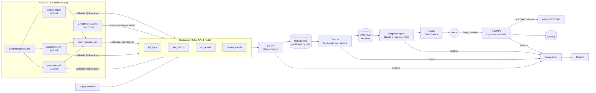

# Architecture

Target architecture across all six phases. Phases 1–3 implement everything up to and
including the incidents table.

## Design decisions

| # | Decision | Why | Tradeoff |
|---|---|---|---|
| 1 | Detector is a plain Python batch job over bronze, not Spark Structured Streaming and not a Kafka consumer (changed in Phase 3; the plan was a Kafka consumer) | Event volume is tiny. Every detector needs history (last good schema, same-weekday medians, earlier attempts), which bronze already holds and a stream would rebuild as state. Pure functions: deterministic, replayable, easy to test. One pass takes about 1.3 s and peaks at about 500 MiB; no JVM | Latency = how often it runs (one-shot `make detect` now; scheduled in Phase 6). Re-reads `history_days` of bronze each pass, which is fine at this volume. At scale: incremental reads by `event_date` plus a state table |
| 2 | The lander writes Delta through `delta-rs`; Spark only runs inside jobs | No Spark session per micro-batch. The tables are still real Delta | Two Delta writers. Protocol compatibility is verified by tests (GX reads Spark-written tables through delta-rs) |
| 3 | PySpark in local mode inside the Airflow image; the `spark` pool caps concurrent JVMs at 2 | Fits an 8 GB Docker budget (measured peak 4.2 GB), and there's no cross-container submit | Not distributed locally. The job code is unchanged on a cluster or on Glue |
| 4 | Glue job via the `glue_compat` shim | LocalStack Glue is paid; the same script runs on real Glue | DynamicFrames, bookmarks and the catalog aren't exercised locally |
| 5 | Jobs run in a separate venv (`/opt/venv/jobs`) via `BashOperator` | Spark/GX deps never fight Airflow's constraint set. Mirrors production, where Airflow orchestrates and compute runs elsewhere | A process start per task (about 1 s, negligible next to JVM start-up) |
| 6 | Versioned Pydantic event envelope with a discriminated payload; `extra="forbid"` | Typed contracts. Unknown fields fail loudly | Producers and consumers must upgrade together on breaking changes (`SCHEMA_VERSION`) |
| 7 | Instrumentation is a Python context manager, not a JVM SparkListener | Captures duration, rows, observed input schema and exceptions. Testable without Spark | No per-stage metrics |
| 8 | GX suites are defined in code, not JSON | Freshness bounds depend on `ds` | Suites are versioned by `SUITE_VERSION` instead of a stored artifact |
| 9 | GX validates via pandas, reading Delta with delta-rs | Partitions are about 2k rows, and this avoids a second JVM start per DAG | Wouldn't scale to large partitions; use GX's Spark datasource there |
| 10 | No silent dedupe in ingestion | Duplicates indicate an upstream bug; DQ should fail loudly so detection sees it | A duplicate load stops the pipeline instead of being absorbed |
| 11 | DAGs have `schedule=None` locally; `make run-all` and the fault harness pick logical dates | Deterministic runs for replay and the benchmark | Set a cron for a real deployment |
| 12 | No automatic task retries | A failure becomes an incident immediately; the human-approved Retry button is the retry path | Transient blips also surface (suppression in Phase 3 keeps the noise down) |
| 13 | Redpanda instead of Kafka + KRaft | Kafka-API compatible, single binary, about 240 MiB RSS measured | Not byte-for-byte Kafka; the client code is identical |
| 14 | Spark 3.5.4 / Delta 3.3.0 / Python 3.11 | Mirrors AWS Glue 5.0, so the local job and the Glue job match | Not the newest Spark (4.x) |
| 15 | `customers` is SCD1 (current state); its freshness check has no upper bound | Backfilling an older ds after a newer load is legitimate (found by running a Saturday after a Tuesday) | `daily_revenue` for a backfilled ds joins *current* customer attributes, not point-in-time ones. SCD2 would fix this; out of scope |
| 16 | Four topics split by *kind of signal* (logs, metrics, DQ, deploys), not by pipeline | Each detector reads one or two kinds across all pipelines; retention and volume differ by kind (logs are the noisiest); adding a pipeline needs no new topic | Per-pipeline isolation comes from the message key (`pipeline`), which also keeps one pipeline's events ordered within a partition |
| 17 | `task_run` shares `job_metrics` instead of having a fifth topic | Both describe "how an execution went", and the detector joins them | A consumer must branch on `event_type` (the bronze table has it as a column) |
| 18 | Idempotency key = producer-assigned `event_id` (UUID), required on the wire | The id is fixed when the event is created, so every re-delivery or replay carries the same id. Kafka offsets aren't stable across a replay, so they can't be the key | MERGE costs a scan of the target partition per batch (pruned by `event_date`); fine at this volume, compact or OPTIMIZE at scale |
| 19 | Journal-first `TeeSink` (JSONL always, Kafka best-effort) | The broker can't fail a pipeline, and nothing is lost; replay needs no "what was delivered?" bookkeeping because the lander dedupes | Events exist twice locally; a dead broker slows runs about 2× (5 s flush bound per process). Accepted; no circuit breaker |
| 20 | Commit Kafka offsets only after the Delta write; crash on write failure | At-least-once delivery + idempotent MERGE = each event lands exactly once | A poison *write* (not a poison message; those go to dead-letter) crash-loops the lander. That is visible, not silent, and a Prometheus alert is planned for Phase 6 |
| 21 | Bronze partitioned by emitted date, queried by `logical_date` | Emitted date is when something *happened* (retention, time-range scans); ds is the business date the run was for, and a backfill emits today for an old ds | Two dates to keep straight; `make query-bronze` filters on ds |
| 22 | Code version = content hash of each pipeline's files, recorded by `make deploy` | Uncommitted edits (Phase 5 "bad deploy" faults) are versioned too; a shared-module change correctly redeploys every pipeline | Deploys are explicit (`make deploy`), not inferred from Airflow; on AWS this would run in CI/CD |
| 23 | The lander uses static group membership (`group.instance.id`) | After a broker restart, Redpanda restores the old member, and a plain rejoin waited about 30 s for it to expire. A static member replaces it immediately (measured 30 s → 2 s) | Only one process per instance id; a second lander or a `--drain` run needs its own `--instance-id` |
| 24 | Detection reads only bronze | One source of truth that the lander already made idempotent. Detection can be replayed from bronze alone, and it can't be confused by curated tables that a re-run has overwritten | Signals not in events (e.g. table sizes, file arrival times) need a producer first |
| 25 | All thresholds in `config/detection.toml`; every key required, no defaults in code | What you read is what runs. Tests override by deep-merge | Adding a setting means editing the file (a missing key is an error by design) |
| 26 | Volume: robust z (median/MAD) against a per-pipeline baseline (same weekday, or the last 7 days for a growing snapshot), AND a 15% relative-change floor | Median/MAD isn't skewed by past incidents. Same weekday removes the weekly cycle. The floor stops tight history from flagging 7–11% moves (9 clean days a year had \|z\| > 3.5). "recent" stops a growing table looking like a spike (5 clean days a year, found by a full-year replay) | No trend or holiday model. Needs about 3 weeks of runs before z is used; until then only ≥ 50% changes are caught |
| 27 | Freshness is recomputed from GX's observed max, not taken from GX pass/fail | Gives *how* late (severity, and diagnosis in Phase 4). The SLA lives in one file | The GX suite and the config must agree on the SLA (both 24 h for customers) |
| 28 | Correlation: a cause absorbs same-run symptoms; downstream links to upstream by config lineage and timing; the upstream is primary; downstream keeps its own row | One incident per root cause. A linked downstream still resolves (and can be investigated) on its own, so an independent downstream problem never disappears | Lineage is declared, not discovered. A DAG test keeps it in sync with the sensors |
| 29 | Dedup key `pipeline\|type\|fingerprint`; `incident_id = sha256(key)[:10]`; no time window | Stable ids across re-runs, replays and machines; a recurring break collects every affected ds | A recurrence weeks later reopens the old incident instead of opening a new one (open question for Phase 4) |
| 30 | Idempotent upsert: MERGE only rows whose content changed | Re-running detection writes nothing, so Delta history shows real changes only | A full read of the (small) incidents table per pass |
