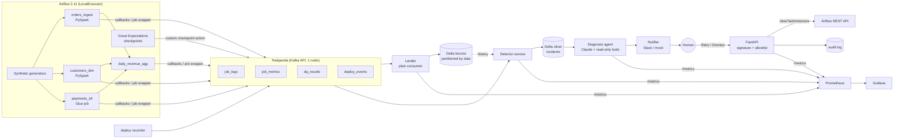

# Architecture

Target architecture across all six phases. Phase 1 implements the "Pipelines" box, the
event schema and the JSONL event sink.

## Design decisions

| # | Decision | Why | Tradeoff |
|---|---|---|---|
| 1 | Detector is a plain Python Kafka consumer, not Spark Structured Streaming | Event volume is tiny. Detectors are pure functions, which are easy to unit test and replay. No JVM | No horizontal scale-out; at-least-once delivery with idempotent `event_id`s |
| 2 | The lander writes Delta through `delta-rs`; Spark only runs inside jobs | No Spark session per micro-batch. The tables are still real Delta | Two Delta writers. Protocol compatibility is verified by tests (GX reads Spark-written tables through delta-rs) |
| 3 | PySpark in local mode inside the Airflow image; the `spark` pool caps concurrent JVMs at 2 | Fits an 8 GB Docker budget (measured peak 4.2 GB), and there's no cross-container submit | Not distributed locally. The job code is unchanged on a cluster or on Glue |
| 4 | Glue job via the `glue_compat` shim | LocalStack Glue is paid; the same script runs on real Glue | DynamicFrames, bookmarks and the catalog aren't exercised locally |
| 5 | Jobs run in a separate venv (`/opt/venv/jobs`) via `BashOperator` | Spark/GX deps never fight Airflow's constraint set. Mirrors production, where Airflow orchestrates and compute runs elsewhere | A process start per task (about 1 s, negligible next to JVM start-up) |
| 6 | Versioned Pydantic event envelope with a discriminated payload; `extra="forbid"` | Typed contracts. Unknown fields fail loudly | Producers and consumers must upgrade together on breaking changes (`SCHEMA_VERSION`) |
| 7 | Instrumentation is a Python context manager, not a JVM SparkListener | Captures duration, rows, observed input schema and exceptions. Testable without Spark | No per-stage metrics |
| 8 | GX suites are defined in code, not JSON | Freshness bounds depend on `ds` | Suites are versioned by `SUITE_VERSION` instead of a stored artifact |
| 9 | GX validates via pandas, reading Delta with delta-rs | Partitions are about 2k rows, and this avoids a second JVM start per DAG | Wouldn't scale to large partitions; use GX's Spark datasource there |
| 10 | No silent dedupe in ingestion | Duplicates indicate an upstream bug; DQ should fail loudly so detection sees it | A duplicate load stops the pipeline instead of being absorbed |
| 11 | DAGs have `schedule=None` locally; `make run-all` and the fault harness pick logical dates | Deterministic runs for replay and the benchmark | Set a cron for a real deployment |
| 12 | No automatic task retries | A failure becomes an incident immediately; the human-approved Retry button is the retry path | Transient blips also surface (suppression in Phase 3 keeps the noise down) |
| 13 | Redpanda instead of Kafka + KRaft | Kafka-API compatible, single binary, about 240 MiB RSS measured | Not byte-for-byte Kafka; the client code is identical |
| 14 | Spark 3.5.4 / Delta 3.3.0 / Python 3.11 | Mirrors AWS Glue 5.0, so the local job and the Glue job match | Not the newest Spark (4.x) |
| 15 | `customers` is SCD1 (current state); its freshness check has no upper bound | Backfilling an older ds after a newer load is legitimate (found by running a Saturday after a Tuesday) | `daily_revenue` for a backfilled ds joins *current* customer attributes, not point-in-time ones. SCD2 would fix this; out of scope |
